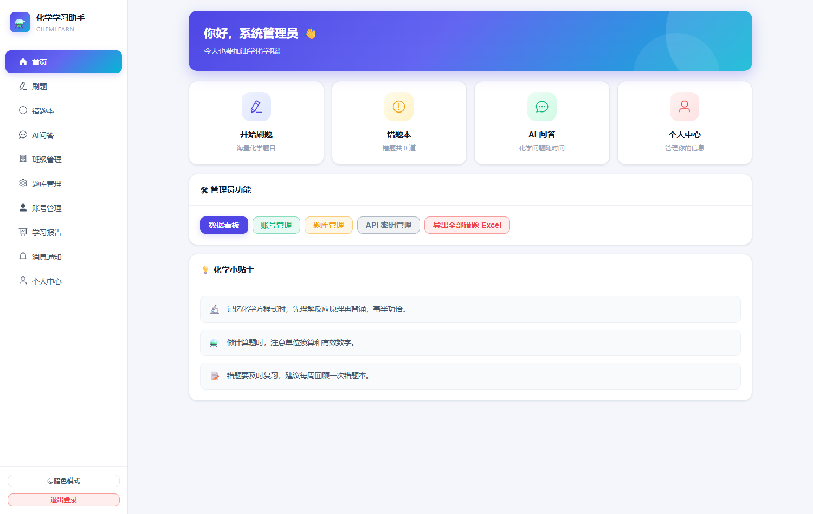
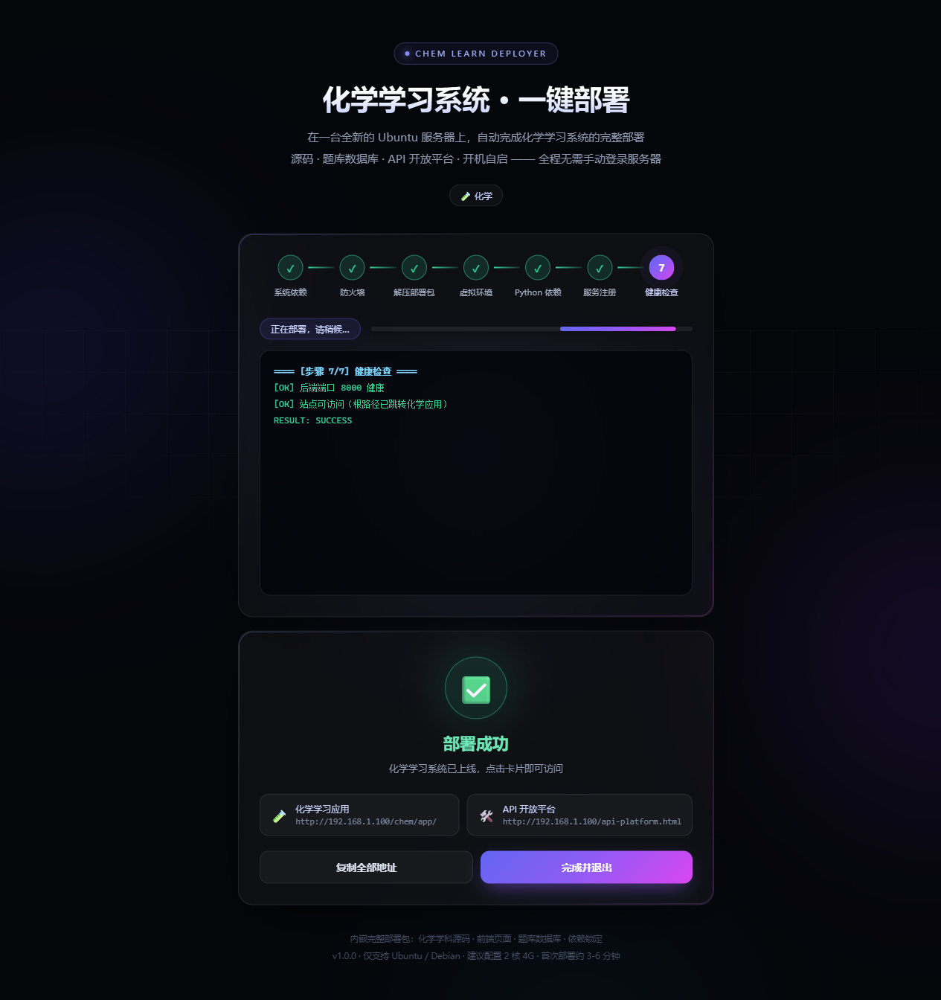

# 化学学习系统 · ChemLearn

一个面向高中化学的在线学习平台：题库刷题、错题本、AI 问答、班级与作业管理、学习报告，
并附带两套一键部署工具（Linux 服务器 / Windows 本机）。

前后端分离，单机可跑，数据存放在 SQLite，不需要额外安装数据库。



---

## 功能

| 模块 | 说明 |
|---|---|
| 刷题 | 按章节 / 题型 / 难度筛选，支持顺序练习与随机组卷，答题即时判分 |
| 错题本 | 自动收录错题，支持重做、导出 Excel |
| AI 问答 | 接入大模型 API，针对题目做讲解（Key 可在管理端配置） |
| 班级管理 | 建班、邀请学生、查看班级练习情况 |
| 作业 / 考试 | 布置作业与考试，自动统计得分与正确率 |
| 题库管理 | 后台增删改查题目，支持 Excel / PDF 批量导入 |
| 账号管理 | 学生/教师/管理员三种角色，支持批量导入与密码重置 |
| 学习报告 | 个人与班级维度的正确率、知识点掌握度统计 |
| 消息通知 | 站内通知推送 |
| API 开放平台 | 为第三方应用签发 API Key，按 scope 与日限额调用 |

## 技术栈

- **后端**：FastAPI · SQLAlchemy 2.x（async + aiosqlite）· Pydantic v2 · Passlib/bcrypt · PyJWT
- **前端**：Vue 3 · Vite · Element Plus · ECharts · KaTeX
- **打包安装**：Capacitor（Android）
- **部署**：nginx 反向代理 + systemd；另提供 SSH 一键部署器与 Windows 单文件运行器

## 目录结构

```
chemlearn/
├── backend/                # FastAPI 后端
│   ├── app/
│   │   ├── api/            # 路由（auth / questions / practice / classes / exams ...）
│   │   ├── core/           # 配置、数据库、安全
│   │   ├── models/         # ORM 模型
│   │   ├── services/       # 业务服务（AI、缓存、邮件、判分 ...）
│   │   └── main.py         # 入口，含 SPA 静态托管
│   ├── alembic/            # 数据库迁移
│   ├── import_data/        # 题库 JSON（导入用）
│   ├── tests/              # pytest
│   └── requirements.txt
├── web/                    # Vue 3 前端（含 Capacitor Android 工程）
├── deployer/
│   ├── linux/              # SSH 一键部署器（deployer.py 六学科版 / deployer_chem.py 纯化学版）
│   └── windows/            # Windows 单文件运行器（PyInstaller）
└── docs/                   # 截图
```

## 本地运行

### 1. 后端

```bash
cd backend
python -m venv .venv
# Windows: .venv\Scripts\activate    macOS/Linux: source .venv/bin/activate
pip install -r requirements.txt
cp .env.example .env          # 按需修改 SECRET_KEY / ADMIN_PASSWORD
uvicorn app.main:app --reload --port 8000
```

启动后：

- 接口文档 <http://127.0.0.1:8000/api/docs>（ReDoc：`/api/redoc`，OpenAPI：`/api/openapi.json`）
- 健康检查 <http://127.0.0.1:8000/api/health>
- 首次启动会自动建表并创建管理员 **admin / admin123**

### 2. 导入题库（可选）

```bash
cd backend
python import_gaokao_unified.py        # 按 import_data/*.json 导入
```

### 3. 前端

```bash
cd web
npm install
npm run build                          # 产物在 web/dist/app
npm run dev                            # 或本地开发（需在 vite.config.js 配置代理）
```

前端默认按 `/chem/app/` 作为静态路径、`/chem/api/v1` 作为接口前缀（与 nginx 子路径部署一致）。
若想让后端直接托管前端，把 `web/dist/app` 放到 `backend/../web/dist/app` 位置再启动即可，
后端已内置 SPA 静态托管与深链接回退。

## 部署

### Linux 服务器一键部署

`deployer/linux/deployer_chem.py` 是一个带 Web 界面的部署器：填目标服务器 IP / 账号 / 密码，
自动完成安装依赖、创建 venv、写 systemd 服务、配置 nginx 反代、健康检查。

```bash
python deployer/linux/build_chem.py            # 先打部署包（需自备 assets，见脚本注释）
python deployer/linux/deployer_chem.py         # 启动部署器界面 http://127.0.0.1:8765
```

也支持无界面运行：

```bash
python deployer/linux/deployer_chem.py --host 10.0.0.10 --user root --password '***' --web-port 80
```

### Windows 单文件运行

`deployer/windows/` 把后端 + 前端 + 题库打成一个 exe，双击即可在本机跑起来，局域网可访问，
无需安装 Python。

```bash
pip install pyinstaller
python deployer/windows/build_win.py           # 需要 payload_chem.tar.gz 放在同目录
# 产物 deployer/windows/out/ChemLearnWindows.exe
```

运行：`ChemLearnWindows.exe [--port 8000] [--no-browser] [--reset]`，
首次运行解压到 `%LOCALAPPDATA%\ChemLearnWindows`，数据即保存在该目录。



## 默认账号与安全提醒

> **本仓库是学习与工程实践项目，默认配置不可直接用于生产。**

- 默认管理员：`admin / admin123`；新建用户与重置密码的默认值为 `111111`。
  上线前请在 `.env` 中设置 `ADMIN_PASSWORD`，并修改 `app/api/admin_users.py` 中的默认密码。
- `.env.example` 里的 `SECRET_KEY` 是占位值。当 `DEBUG=false` 时后端会拒绝使用默认
  `SECRET_KEY` / `ADMIN_PASSWORD` 启动（见 `app/core/config.py` 的启动校验）。
- AI Key、SMTP 密码等敏感项一律通过环境变量注入，不要写进代码。

## 许可

[MIT](LICENSE)
