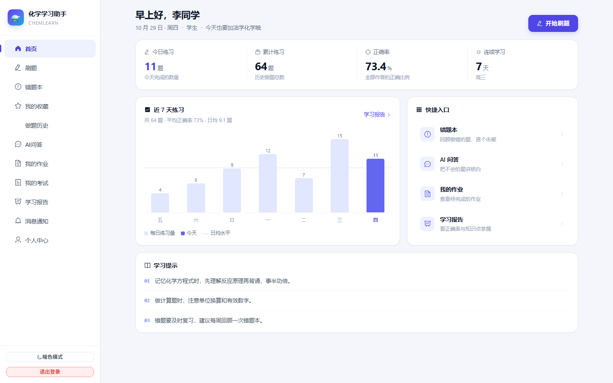
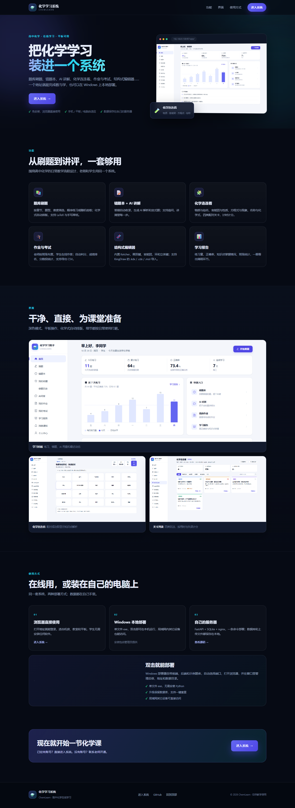
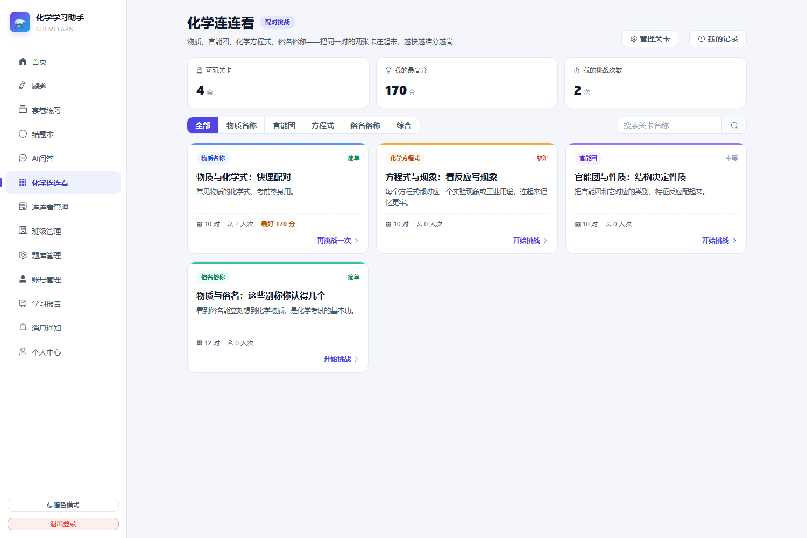
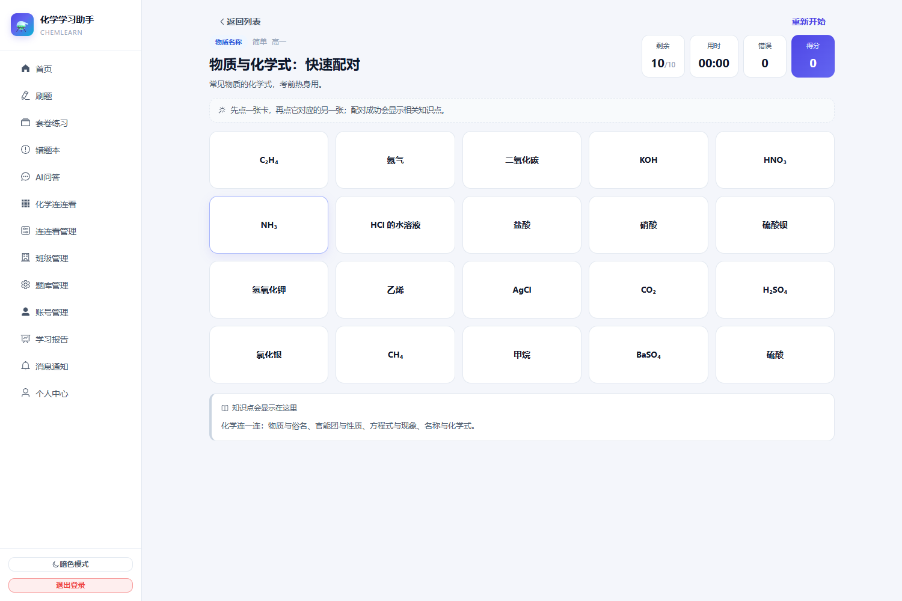
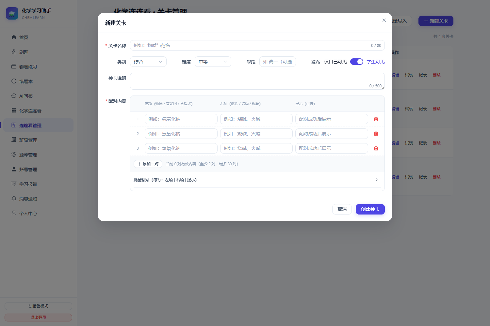
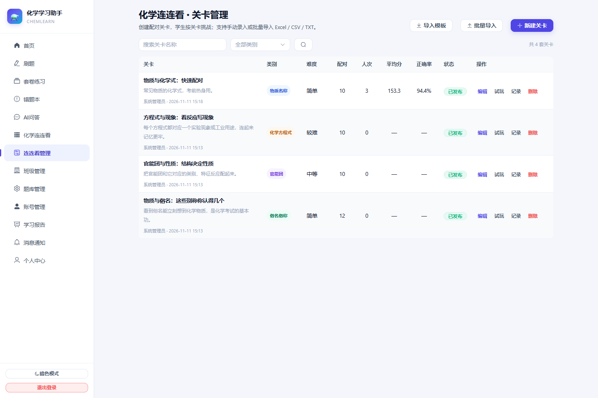
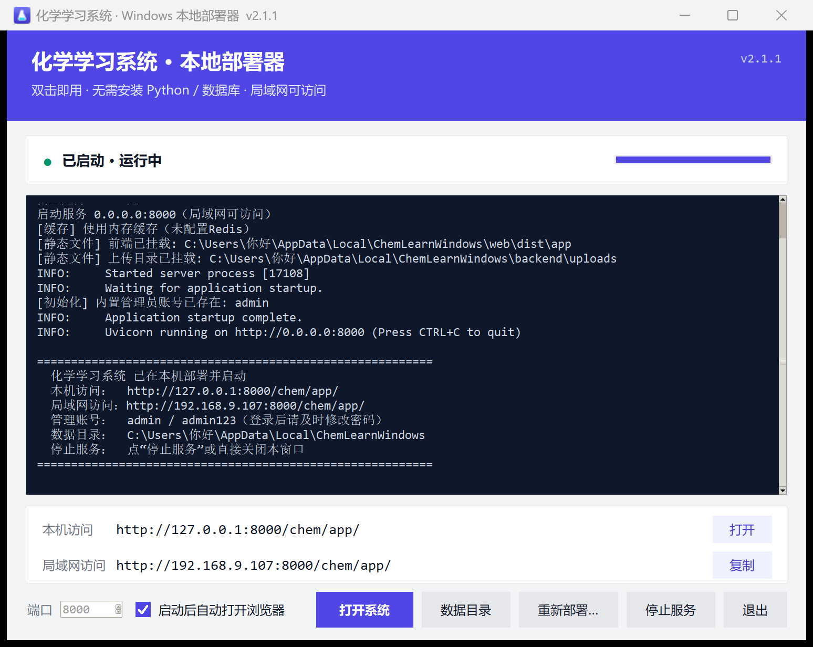

# 化学学习系统 · ChemLearn

[](https://github.com/houshibo0101/chemlearn/actions/workflows/ci.yml)

一个面向高中化学的在线学习平台：题库刷题、错题本、AI 问答、班级与作业管理、学习报告，
并附带两套一键部署工具（Linux 服务器 / Windows 本机）。

前后端分离，单机可跑，数据存放在 SQLite，不需要额外安装数据库。



---

## 文档

完整使用文档在 **[Wiki](https://github.com/houshibo0101/chemlearn/wiki)**：

| 文档 | 内容 |
|---|---|
| [快速开始](https://github.com/houshibo0101/chemlearn/wiki/Quick-Start) | 三种部署方式的完整步骤 |
| [功能说明](https://github.com/houshibo0101/chemlearn/wiki/Features) | 学生 / 老师 / 管理员各能做什么 |
| [套卷练习](https://github.com/houshibo0101/chemlearn/wiki/Exam-Papers) | 上传 PDF → AI 结构化 → 题目自动入库 → 带图题裁剪 → 判分；时长可调，题目校对支持填空题多级小问各自答题框和分值 |
| [AI 配置](https://github.com/houshibo0101/chemlearn/wiki/AI-Setup) | 双模型分工、换模型、报错对照 |
| [部署指南](https://github.com/houshibo0101/chemlearn/wiki/Deployment) | 端口、systemd、nginx、备份、升级 |
| [常见问题](https://github.com/houshibo0101/chemlearn/wiki/FAQ) | 登录、AI、上传、性能 |
| [开发指南](https://github.com/houshibo0101/chemlearn/wiki/Development) | 目录结构、本地运行、踩过的坑 |

---

## 下载

一键部署工具（无需安装 Python，双击即用）单独发布，不放仓库以免体积膨胀：

| 文件 | 平台 | 说明 |
|---|---|---|
| [ChemLearn-Deployer-v1.3.0.exe](https://github.com/houshibo0101/chemlearn/releases/tag/v1.3.0) | Linux 服务器 | 填 IP、SSH 密码和 AI Key，自动装好 nginx / Python / systemd，3–6 分钟完成 |
| [ChemLearnWindows-v2.1.37.exe](https://github.com/houshibo0101/chemlearn/releases/tag/windows-v2.1.37) | Windows 本机 | 双击部署到本机，界面里看地址 / 开系统 / 重置，局域网可访问 |
| [题库数据包 453 题](https://github.com/houshibo0101/chemlearn/releases/tag/question-bank-v1) | 通用 | 解压到 `backend/import_data/` 后跑导入脚本 |

> Linux 部署器内置完整部署包（源码 + 前端 + 依赖清单），目标机只需能联网的 Ubuntu / Debian。
> Windows 部署器把依赖和题库全部打进 exe（约 87 MB），目标机完全离线也能用。
> AI 配置在部署时写入，装完即可用。

---

## 官网首页

访问 `/chem/` 显示官网落地页，点「进入系统」跳到 `/chem/app/`。



## 功能

| 模块 | 说明 |
|---|---|
| 刷题 | 按章节 / 题型 / 难度筛选，支持顺序练习与随机组卷，答题即时判分；草纸支持手写（笔 / 橡皮 / 三色 / 撤销 / 清空），平板可用 |
| 化学连连看 | 物质 / 官能团 / 方程式 / 俗称配对闯关，计时计分、连击、排行榜，老师可上传关卡 |
| 错题本 | 自动收录错题，支持重做、导出 Excel |
| AI 问答 | 接入大模型 API，针对题目做讲解；只回答化学相关问题，学生累计 5 次无关提问会停用，老师可在班级学生列表解封；管理员点「AI Token 消耗」卡片可改接口 / Key / 模型 |
| 班级管理 | 建班、邀请学生、查看班级练习情况 |
| 作业 / 考试 | 布置作业与考试；考试支持设置时长、总分、时间、班级、题目与分值，自动统计得分与正确率 |
| 题库管理 | 后台增删改查题目，支持 Excel / PDF 批量导入 |
| 账号管理 | 学生/教师/管理员三种角色，支持四列 Excel 批量导入（姓名 / 学段 / 班级 / 身份）与密码重置 |
| 学习报告 | 个人与班级维度的正确率、知识点掌握度统计 |
| 消息通知 | 站内通知推送 |
| API 开放平台 | 为第三方应用签发 API Key，按 scope 与日限额调用 |

### 化学连连看

把**物质与俗名、官能团与性质、化学方程式与实验现象、名称与化学式**做成配对关卡：
2–30 对卡片打乱后，找出属于同一对的两张，全部配完按用时、错误次数和连击计分，
配对成功会显示知识点解析。

- 学生：选关卡 → 配对 → 看解析与排行榜
- 老师 / 管理员：手动录入、批量粘贴，或上传 Excel / CSV / TXT 建关卡；按关卡看学生成绩
- 内置 4 套示例关卡（俗名 / 官能团 / 方程式 / 化学式），也可执行 `backend/seed_matching.py` 重新灌入

<p>
  
  
</p>
<p>
  
  
</p>

### 公式与化学式（自动排版）

题干、选项、解析、错题解析、AI 回答、连连看卡片都支持公式渲染，也支持**纯文本化学式自动排版**：

- 直接写 `H2`、`H2SO4`、`Ca(OH)2`，显示为 H₂、H₂SO₄、Ca(OH)₂
- 结晶水 `CuSO4·5H2O`、有机物 `CH3COOH` 同样识别
- 电荷用 `^`：`Fe^3+` → Fe³⁺，`SO4^2-` → SO₄²⁻
- 也支持 LaTeX：行内 `$H_2SO_4$`，块级 `$$\Delta H < 0$$`，化学式 `\ce{2Na + 2H2O -> 2NaOH + H2 ^}`

自动排版只改变显示，数据库仍保存原文，因此答案判分不受影响；手动录入（编辑框有实时预览）、批量导入、作业/考试答题预览都会生效。**正确答案**字段下方同样有实时预览，答题结果页的正确答案也会自动排版。

### 结构式编辑器（Ketcher）

题库管理 → 上传题目 → 题目图片 → 「画结构式 / 导入 KingDraw」，内置 [Ketcher](https://github.com/epam/ketcher)（Apache-2.0）：

- 支持单/双/三键、芳香环、环模板、官能团、电荷、立体楔形键，平板可直接点按绘制
- **KingDraw 新版 `.kdx` 可直接导入**：后端解析 zip 里的 `protocol` 原子/键坐标，转成可编辑结构
- 也支持 KingDraw 导出的 `.cdx`、`.mol`、`.sdf`，以及 `.smi` / `.smiles` / `.cdxml`
- KingDraw 操作：直接「另存为」`.kdx`；或「另存为」`.cdx` / `.mol`；或右键「复制为」SMILES/MOL
- 老式 `.king` 是私有格式，暂不支持；`.kdx` 解析失败时会退回文件内嵌的预览图
- 画完点「插入到题目」，会生成 PNG 图片存入题目图片，学生端、作业、考试直接显示

结构式目前作为图片展示，不参与自动判分；学生若要画结构作答，需要人工批改，可后续再加。

## 技术栈

- **后端**：FastAPI · SQLAlchemy 2.x（async + aiosqlite）· Pydantic v2 · Passlib/bcrypt · PyJWT
- **前端**：Vue 3 · Vite · Element Plus · ECharts · KaTeX
- **打包安装**：Capacitor（Android）
- **部署**：nginx 反向代理 + systemd；另提供 SSH 一键部署器与 Windows 本机部署器

## 目录结构

```
chemlearn/
├── backend/                # FastAPI 后端
│   ├── app/
│   │   ├── api/            # 路由（auth / questions / practice / classes / exams ...）
│   │   ├── core/           # 配置、数据库、安全
│   │   ├── models/         # ORM 模型
│   │   ├── services/       # 业务服务（AI、缓存、邮件、判分 ...）
│   │   └── main.py         # 入口，含 SPA 静态托管
│   ├── alembic/            # 数据库迁移
│   ├── import_data/        # 题库目录（JSON 需从 Releases 下载，见下文）
│   ├── tests/              # pytest
│   └── requirements.txt
├── web/                    # Vue 3 前端（含 Capacitor Android 工程）
├── deployer/
│   ├── linux/              # SSH 一键部署器（deployer.py 六学科版 / deployer_chem.py 纯化学版）
│   └── windows/            # Windows 本机部署器（PyInstaller 单文件 exe，图形界面）
└── docs/                   # 截图
```

## 本地运行

### 1. 后端

```bash
cd backend
python -m venv .venv
# Windows: .venv\Scripts\activate    macOS/Linux: source .venv/bin/activate
pip install -r requirements.txt
cp .env.example .env          # 按需修改 SECRET_KEY / ADMIN_PASSWORD
uvicorn app.main:app --reload --port 8000
```

启动后：

- 接口文档 <http://127.0.0.1:8000/api/docs>（ReDoc：`/api/redoc`，OpenAPI：`/api/openapi.json`）
- 健康检查 <http://127.0.0.1:8000/api/health>
- 首次启动会自动建表并创建独立管理员账号（不在普通账户列表中显示）

### 邮箱验证码（注册）

注册默认要求邮箱验证码，需先在 `backend/.env` 配置 SMTP：

```ini
SMTP_HOST=smtp.qq.com
SMTP_PORT=465
SMTP_USER=你的邮箱@qq.com
SMTP_PASSWORD=邮箱授权码
SMTP_FROM=你的邮箱@qq.com
SMTP_USE_TLS=false
SMTP_USE_SSL=true
REQUIRE_EMAIL_VERIFICATION=true
```

QQ 邮箱用 465 端口 + SSL，密码填邮箱设置里的「授权码」而不是登录密码。
SMTP 未配置时，注册页点发送验证码会提示「邮件服务未配置」。
本地调试可设 `SMTP_DEBUG=true` 直接返回验证码；生产必须保持 `false`。

### 使用 DeepSeek Flash

在管理员「账号管理 → AI Token 消耗」里填：

```text
API 地址：https://api.deepseek.com
模型：    deepseek-flash
API Key： sk-...（platform.deepseek.com 创建）
```

应用调用的是 OpenAI 兼容接口 `/chat/completions`，地址不要带 `/chat/completions`。
DeepSeek Flash 默认开启思考模式，首次响应可能较慢；如遇超时可在 `.env` 中把
`AI_TIMEOUT` 调到 `120`。当前应用不传 `thinking` 参数，因此使用默认思考模式，
`temperature` 会被忽略但不会报错。

### 2. 导入题库（可选）

题库不随源码分发，单独打包放在 Releases：

**[下载 chemlearn-question-bank-453.zip](https://github.com/houshibo0101/chemlearn/releases/tag/question-bank-v1)**（453 道高考化学题，134 KB）

下载解压后，把其中的 `*.json` 放进 `backend/import_data/`，然后执行：

```bash
cd backend
python import_gaokao_unified.py        # 按 import_data/*.json 导入
```

没有题库也能正常使用系统，只是题目列表为空，可在后台「题库管理」里自己录入或导入 Excel / PDF。
数据格式见 [`backend/import_data/README.md`](backend/import_data/README.md)。

### 3. 前端

```bash
cd web
npm install
npm run build                          # 产物在 web/dist/app
npm run dev                            # 或本地开发（需在 vite.config.js 配置代理）
```

### 4. 跑测试

```bash
cd backend
pip install -r requirements-dev.txt    # 含 pytest / pytest-asyncio
pytest -q                              # 使用独立的 test_chemlearn.db，不碰开发库
```

前端默认按 `/chem/app/` 作为静态路径、`/chem/api/v1` 作为接口前缀（与 nginx 子路径部署一致）。
若想让后端直接托管前端，把 `web/dist/app` 放到 `backend/../web/dist/app` 位置再启动即可，
后端已内置 SPA 静态托管与深链接回退。

## 部署

### Linux 服务器一键部署

`deployer/linux/deployer_chem.py` 是一个带 Web 界面的部署器：填目标服务器 IP / 账号 / 密码，
自动完成安装依赖、创建 venv、写 systemd 服务、配置 nginx 反代、健康检查。

```bash
python deployer/linux/build_chem.py            # 先打部署包（需自备 assets，见脚本注释）
python deployer/linux/deployer_chem.py         # 启动部署器界面 http://127.0.0.1:8765
```

也支持无界面运行：

```bash
python deployer/linux/deployer_chem.py --host 10.0.0.10 --user root --password '***' --web-port 80
```

### Windows 本机一键部署

`deployer/windows/` 把前端、后端和题库打成一个 exe，双击即可在本机部署整套系统，
无需安装 Python / 数据库，局域网内其它设备也能访问。

```bash
python -m venv deployer/windows/.buildenv
deployer/windows/.buildenv/Scripts/python -m pip install -r deployer/windows/requirements-build.txt
deployer/windows/.buildenv/Scripts/python deployer/windows/build_win.py --with-payload --fresh
# 产物 deployer/windows/out/ChemLearnWindows.exe（约 87 MB，单文件）
```

运行：`ChemLearnWindows.exe [--port 8000] [--no-browser] [--reset]`。

- 首次运行把运行时解压到 `%LOCALAPPDATA%\ChemLearnWindows`，数据库存在 `backend\chemlearn.db`
- 窗口里可以直接：打开系统、复制局域网地址、打开数据目录、停止服务、重新部署
- 「设置…」里可选填：邮件 SMTP（注册验证码）、AI API 地址/Key、上传文件目录；全部可留空
- 换新 exe 直接双击即可升级，程序会更新而数据库保留；`--reset` 才清空数据
- 内置 4 套化学连连看示例关卡，装好即可直接玩
- 管理员账号为独立账号，不在普通账户列表和部署提示中显示

详细操作、防火墙设置、备份与卸载见 [`deployer/windows/使用说明.txt`](deployer/windows/使用说明.txt)。

### 备份策略

- 所有升级前的备份只写服务器 `/home/mc/studycenter/化学/backups/`：
  - `backend/` 后端 app 历史版本
  - `frontend/` 前端 dist/app 历史版本
  - `db/` 数据库备份
- 本地仓库不保留备份副本，只保留源码和构建工具
- 数据库备份脚本 [`backend/backup_db.sh`](backend/backup_db.sh)，默认保留最近 7 天



## 账号与安全提醒

> **本仓库是学习与工程实践项目，默认配置不可直接用于生产。**

- 管理员账号独立于普通账户：不出现在账号管理列表、不计入用户统计、部署界面不提示。
  上线前请在 `.env` 中设置 `ADMIN_USERNAME` / `ADMIN_PASSWORD`。
- 新建用户与重置密码的默认值为 `111111`，请提醒用户首次登录后修改。
- `.env.example` 里的 `SECRET_KEY` 是占位值。当 `DEBUG=false` 时后端会拒绝使用默认
  `SECRET_KEY` / `ADMIN_PASSWORD` 启动（见 `app/core/config.py` 的启动校验）。
- AI Key、SMTP 密码等敏感项一律通过环境变量注入，不要写进代码。

## 许可

[MIT](LICENSE)
## 反馈 Bug

登录后侧边栏「反馈 Bug」，或官网页脚的「反馈 Bug」，会打开预填好的 GitHub Issue
（自动带页面、浏览器、时间）。也可直接访问
[新建 Issue](https://github.com/houshibo0101/chemlearn/issues/new?labels=bug&template=bug_report.yml)。
没有 GitHub 账号可点「复制报告」发给管理员。
